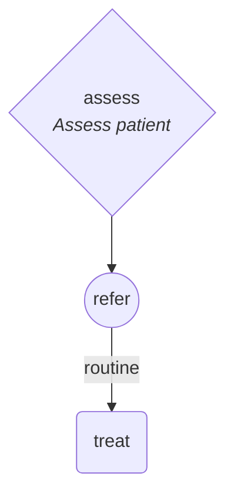

<p align="center">
  <picture>
    <source media="(prefers-color-scheme: dark)" srcset="assets/logo-dark.svg">
    
  </picture>
</p>


[](https://github.com/Minitour/proforma/actions/workflows/ci.yml)
[](https://opensource.org/licenses/MIT)

An [MCP](https://modelcontextprotocol.io) server **and CLI** that lets AI agents (and people) read,
edit, validate and diagram **PROforma** clinical guideline files (`.pf`) — the format authored by
Deontics Composer. Written in Rust, a single native binary per platform, distributed on npm.

* **Understands the language**: a parser that follows the reference grammar exactly (operator
  precedence, non-associative comparisons, greedy nested blocks, reserved words, `/** **/`
  comments), plus a semantic model of plans, components, scheduling, decisions, arguments,
  enquiries, sources, data items and functions.
* **CRUD with integrity**: create tasks in plans, add candidates/arguments/sources/data items,
  set or remove any attribute, rename with reference refactoring, cascade deletes, reject
  scheduling cycles — every edit is re-parsed before it is saved.
* **Lint like Composer**: the engine's own load-time and verifier checks with its exact
  messages (type checking of preconditions, recommendations, arguments, derivations, ranges…),
  plus checks for constructs that make Composer crash or corrupt files.
* **Byte-compatible output**: files are written in Composer's exact layout (CRLF, 5-space
  indent, attribute order, spacing quirks, component ordering), so diffs stay minimal and files
  open in Composer unchanged.
* **Mermaid export**: plans as flowcharts with Composer's shapes and colours, scheduling arrows,
  nested sub-plans and decision branch labels.

> Independent, clean-room implementation for research and interoperability. Not affiliated with
> or endorsed by Deontics. This repository contains no Deontics code.

## Install

```bash
npx proforma-mcp --help        # run without installing
npm install -g proforma-mcp    # or install globally -> `proforma` command
cargo install --git https://github.com/Minitour/proforma   # or build from source (Rust 1.88+)
```

## Use as an MCP server

```json
{
  "mcpServers": {
    "proforma": { "command": "npx", "args": ["-y", "proforma-mcp", "serve"] }
  }
}
```

Claude Code: `claude mcp add proforma -- npx -y proforma-mcp serve`

`proforma serve --transport http --port 8080` serves Streamable HTTP at `http://127.0.0.1:8080/mcp`.

### Tools

| Tool | Purpose |
|---|---|
| `proforma_reference` | Language reference for agents (syntax, semantics, built-ins, editing conventions) |
| `outline` | Task tree from the root plan with scheduling, candidates, sources; data items; functions |
| `list_components` | Top-level components with kind, caption, type (filterable) |
| `get_component` | One component or nested element as PROforma text or JSON |
| `find_references` | Where a task / data item / function is used |
| `plan_graph` | A plan's components, layout, flags and dependencies as JSON |
| `search` | Substring search over names, captions and expressions |
| `lint` | Composer-equivalent validation + extra checks |
| `check_expression` | Parse and type-check an expression; show what each name resolves to |
| `to_mermaid` | Mermaid flowchart of a plan |
| `export_json` | Whole guideline as query-friendly JSON (parsed metaprops, resolved plan structure) for scripts |
| `create_guideline` | New valid 1.9 guideline |
| `upsert_component` | Add/replace whole blocks written in PROforma |
| `add_task` | New task definition + component in a plan |
| `add_component` | Reuse an existing task definition in a plan |
| `remove_component` | Delete a task / data item / function (cascading) |
| `rename` | Rename with reference refactoring |
| `set_attribute` / `remove_attribute` | Set or clear any attribute |
| `add_attributes` | Insert attributes / nested elements written in PROforma |
| `remove_element` | Remove a component, candidate, source, argument or warning |
| `schedule_constraint` | Add/remove a scheduling arrow (cycle-checked) |
| `add_candidate` / `add_argument` | Build decisions |
| `add_source` / `add_data_item` | Build enquiries and the data model |
| `set_metadata` | Title, author, version, dates |
| `format` | Rewrite in Composer's canonical layout (upgrades legacy files to 1.9) |

Nested elements are addressed with selectors:
`plan/component:x`, `decision/candidate:c`, `decision/candidate:c/argument:2`,
`enquiry/source:s`, `data/warning_condition:1`.

## Use as a CLI

Every tool is a subcommand:

```bash
proforma create   --file triage.pf --name triage --title "Sore throat triage"
proforma add-task --file triage.pf --plan triage --kind enquiry --name assess --caption "Assess patient"
proforma add-source --file triage.pf --task assess --data temperature --create-type real
proforma add-task --file triage.pf --plan triage --kind decision --name refer --after assess
proforma add-candidate --file triage.pf --decision refer --name urgent --caption "Urgent referral"
proforma add-argument --file triage.pf --decision refer --candidate urgent --support for --condition "temperature > 39.5"
proforma outline  --file triage.pf
proforma lint     --file triage.pf            # exit code 1 when errors are found
proforma mermaid  --file triage.pf --output triage.md
proforma export   --file triage.pf --output triage.json   # JSON model for scripts and queries
proforma check-expression --file triage.pf --expression "result_of(refer) = urgent"
```

## Agent skill

[`skills/proforma`](skills/proforma) is an agent skill (for Claude Code / Claude) that teaches the
guideline-to-PROforma workflow:
1. extract the logic from a guideline;
2. build the `.pf` with the CLI;
3. lint until clean;
4. produce a shareable HTML report with
   [`scripts/build_report.mjs`](skills/proforma/scripts/build_report.mjs).

The report is a self-contained viewer laid out like a guideline editor: task tree, plan canvas with pan, zoom and drill-down into sub-plans, a properties panel, decision tables with evidence grades, the data model and the
source. The skill ships its test cases under `evals/`.

## Examples

Each example has its own folder with the `.pf` file, an HTML viewer and a Mermaid diagram.

| Example | Guideline | Contents |
|---|---|---|
| [`esmo-immunotherapy-toxicity`](examples/esmo-immunotherapy-toxicity) | ESMO 2017, management of toxicities from immunotherapy (Haanen et al., Ann Oncol 2017) | baseline assessment, a surveillance cycle and grade-based management for 9 organ systems ([report](examples/esmo-immunotherapy-toxicity/esmo_irae.html)) |
| [`esmo-cancer-related-fatigue`](examples/esmo-cancer-related-fatigue) | ESMO 2020, cancer-related fatigue (Fabi et al., Ann Oncol 2020) | screening, diagnostic assessment and management ([report](examples/esmo-cancer-related-fatigue/esmo_crf.html)) |
| [`sore-throat`](examples/sore-throat) | tutorial | small guideline built step by step with the CLI |

The ESMO models lint clean, and Deontics' engine loads them with 0 verifier issues. Evidence grades
from the source are attached to the decision arguments.

## Lint codes

| Prefix | Meaning |
|---|---|
| `PF-L` | lexical/syntax errors (Composer refuses to load) |
| `PF-K` | Composer compatibility problems that `format` fixes (attribute order, header) |
| `PF-C`, `PF-R`, `PF-PP`, `PF-G` | engine load-time checks: duplicates, unresolved references, data model, orphans |
| `PF-V` | engine verifier: typing and decision/assertion rules (engine message texts) |
| `PF-X` | extra checks: scheduling cycles, recursive plans, unknown candidates/tasks, constructs that crash Composer's engine or writer, unchecked expressions |

## Example diagram



## Format notes (PROforma 1.9 as written by Composer)

* `engine_version :: '1.9' ;` must be on its own line, otherwise Composer falls back to the legacy
  1.6 parser; a `metadata` block and a top-level `metaprops` line are required in practice.
* Keywords are reserved and case-sensitive; names clashing with keywords must be quoted.
* Duplicate single-valued attributes: the engine keeps the **first**.
* Task definitions that no plan uses are silently dropped by Composer when it saves
  (`proforma` keeps them and reports `PF-G004`).

## Development

```bash
cargo test
cargo clippy --all-targets -- -D warnings
cargo run -- lint --file examples/sore-throat/sore_throat.pf
```

Releases: push a `vX.Y.Z` tag. The release workflow builds Linux/macOS/Windows (x64 + arm64)
binaries and publishes `proforma-mcp` (command: `proforma`) plus the platform packages
`@proforma-mcp/proforma-<os>-<cpu>` to npm with **trusted publishing (GitHub OIDC)** — no npm token is stored
anywhere. The very first version has to be published once from a maintainer's `npm login`
session, because npm can only attach a trusted publisher to an existing package; see
[`scripts/npm-bootstrap.ps1`](scripts/npm-bootstrap.ps1) (Windows PowerShell) or
[`scripts/npm-bootstrap.sh`](scripts/npm-bootstrap.sh) (bash).

## License

MIT
